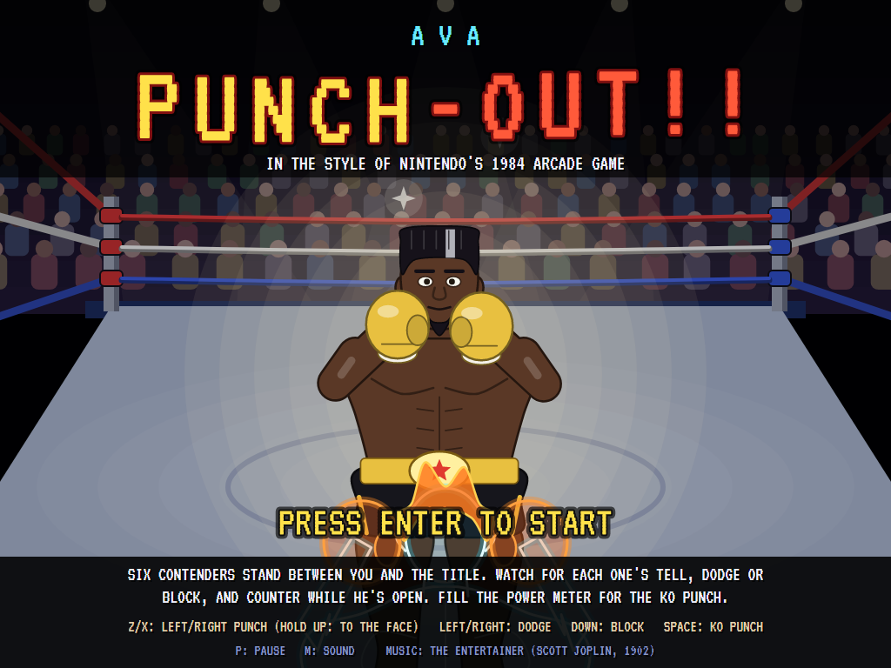
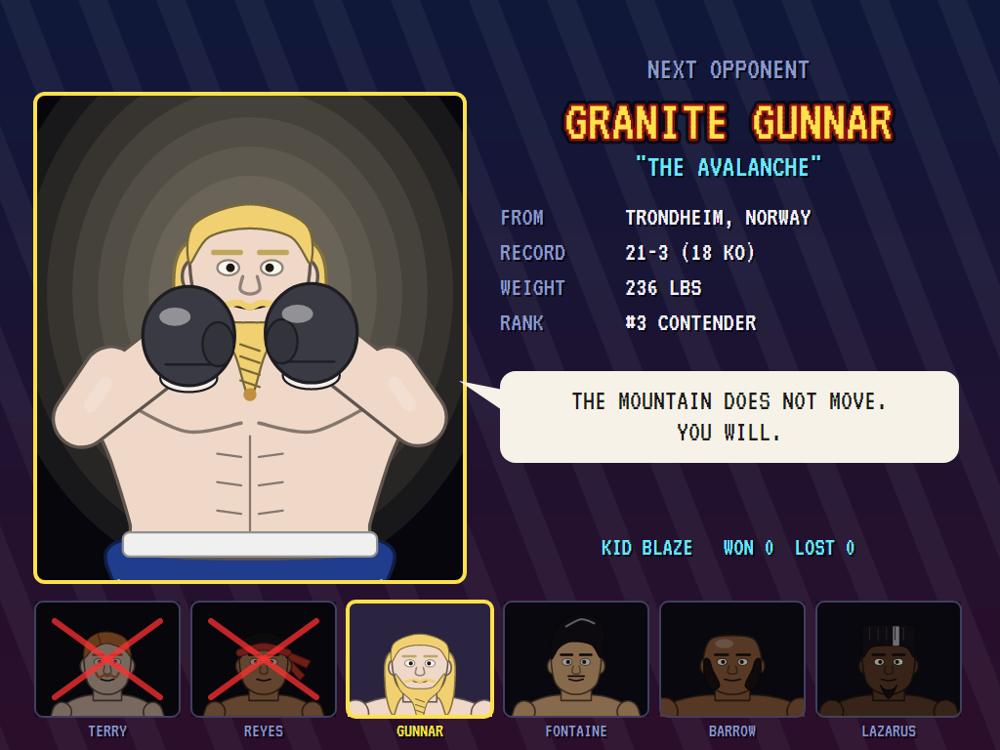
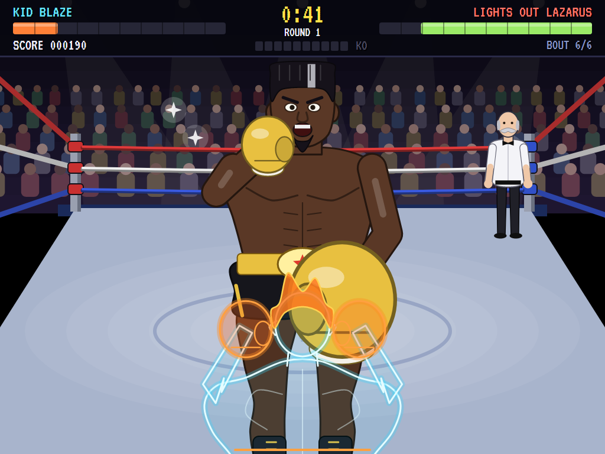
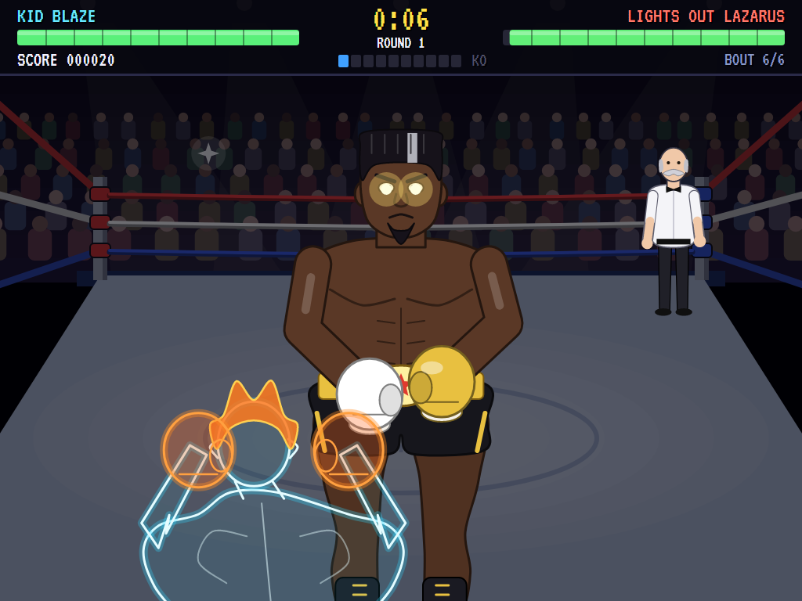
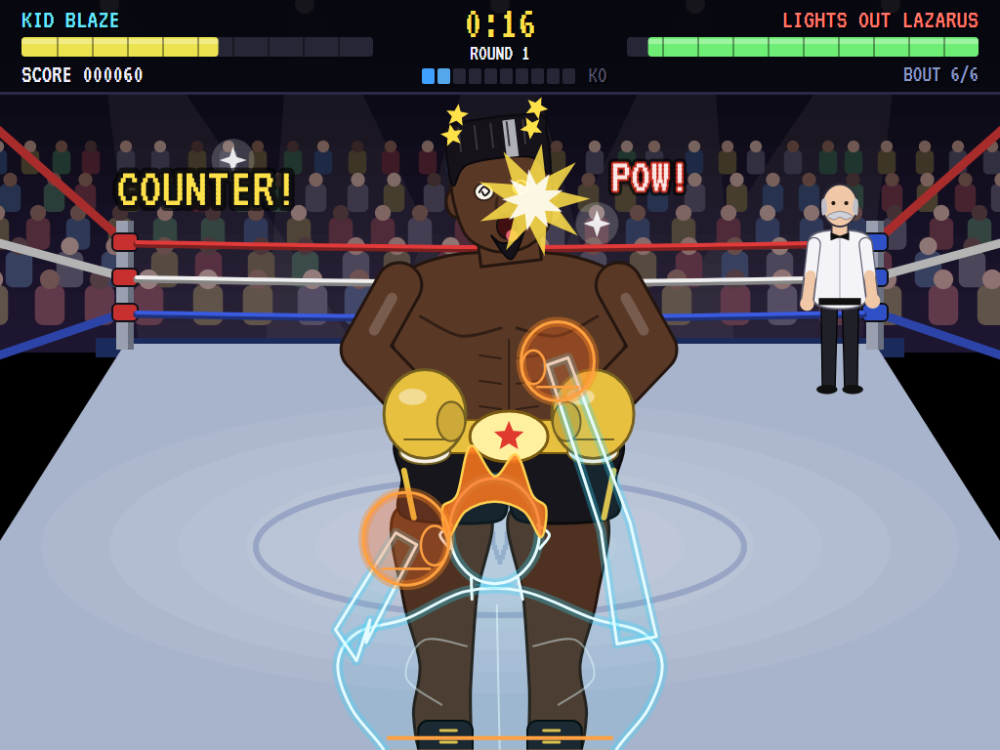
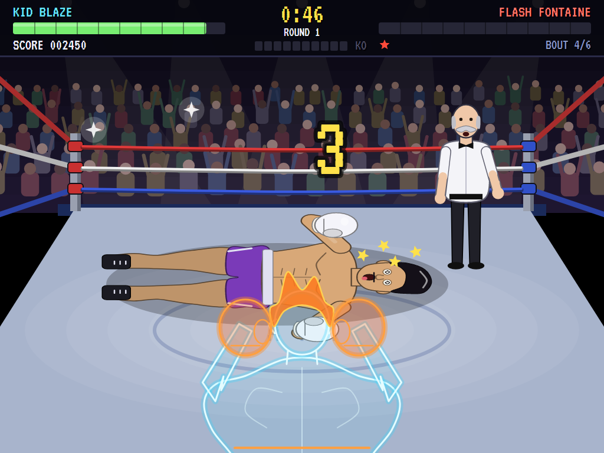
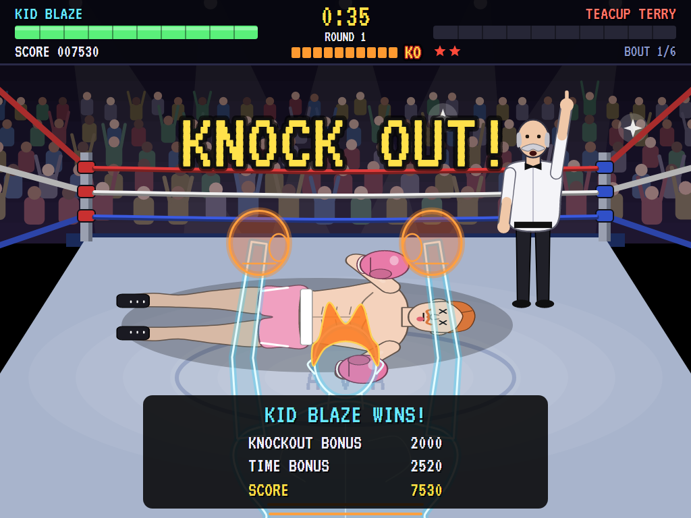
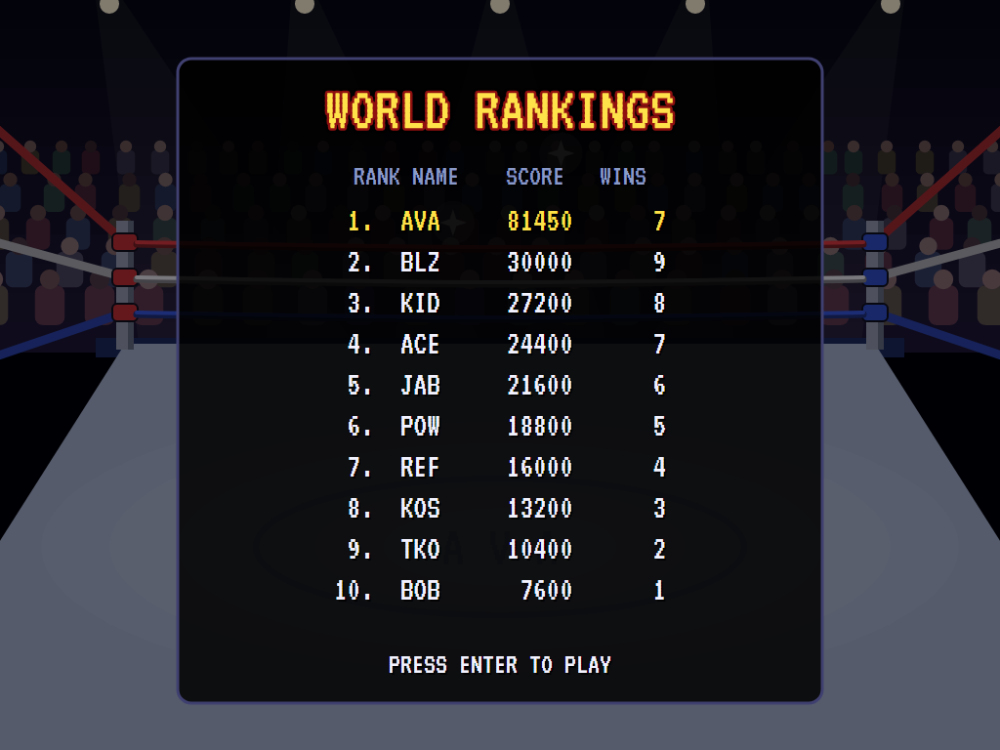

# AVA Punch-Out!!

[](https://github.com/Harlock123/AVAPunchOut/actions/workflows/build.yml)

A boxing game in the style of Nintendo's 1984 arcade **Punch-Out!!**, built with .NET 10 and Avalonia UI.
You are Kid Blaze, seen from behind as a see-through outline, so you watch your opponent through yourself. Six
contenders stand between you and the title, each with his own punches and his own tell. Read the wind-up, slip
the punch or block it, and counter while he's open; fill the power meter and throw the KO punch. Then round the
circuit again, harder.

## Features

- **The arcade's view.** Behind you, over your shoulder: you a wireframe with a flame of orange hair, him big and
  facing you, the ring, the ropes, the crowd with cameras flashing, and the referee, who steps in to count.
- **Punch high or low, left or right.** A punch to the face (hold up as you throw) hurts more than one to the body,
  but either is blocked if his gloves are at that height. Good boxers read your punches and move their guard to
  them; punch into his gloves too often and he jabs straight back.
- **Read his tell, then make him pay.** Every punch of his is wound up first. A jab or a body blow can be blocked or
  slipped either way; a hook blocked, or slipped *away* from the glove; an uppercut only slipped; a haymaker only
  slipped away from; and a smash, too wide to slip, only blocked. Slip it (or block the smash) and he's off balance:
  a counter does half as much again and fills the meter twice as fast. Against the first two, a punch in the
  wind-up beats them to it.
- **The power meter and the KO punch.** A point for each punch that lands, two for a counter. Full, it lights
  up **KO**: Space throws an uppercut that goes through any guard but a cover-up. Get hit and the meter empties.
- **Knockdowns and the count.** Run his stamina out and he goes down; the referee counts, one a second, aloud, and
  he gets up at his own count (later each time), or he's counted out. Down yourself, press punch as fast as you can to
  get up before ten. Three knockdowns in a round is a T.K.O.
- **The clock and the judges.** Three-minute rounds on a clock that runs three times as fast as real time, three
  rounds a fight; go the distance and the judges decide, a point a punch landed and five a knockdown.
- **The circuit**: six opponents of my own, each with a personality, a pattern, a special punch and a tell:
  - **Teacup Terry** of Little Puddleby, 2-31, apologises for everything; he *blushes* pink before he swings, and
    his *Tea Time* haymaker has a sip of tea for a taunt.
  - **Rocket Reyes** of Monterrey: his gloves *glint* before he punches; the *Rocket Flurry* is three uppercuts.
  - **Granite Gunnar** of Trondheim, 236 lbs: he raises both fists over his head, *flashing*, for the *Avalanche*.
    Don't just slip it: a body punch late in the wind-up, and only one, breaks it and drops him.
  - **Flash Fontaine** of Marseille *winks* at the crowd before *Twin Hooks* (one glove, then the other) and the
    *Mirrorball* haymaker.
  - **Big Biscuit Barrow** of Memphis: his belly *wobbles* before the *Gravy Train*, a charge you can only block.
  - **Lights Out Lazarus** of Detroit, the champion, 38-0: the arena lights go *down* and his eyes burn before
    *Lights Out*, three uppercuts, and the *Midnight* haymaker.

  Between fights, a card for the next man: record, weight, home town, rank, and his taunt. Beat the champion and
  the circuit starts again: wind-ups a fifth shorter, punches a quarter harder, and everyone up off the canvas sooner.
- **Scoring:** 10 a body punch, 20 to the face, double for a counter, 300 for the KO punch, 1,000 a knockdown; and
  for a win, a bonus (knockout, T.K.O. or decision) times the bout and the circuit, and 5 for every second left.
  Lose a fight and you get a rematch; lose two and your career is over.
- **The attract mode** shows the computer boxer. It boxes the way the game is meant to be boxed: it waits, reads
  each wind-up, slips the punch the right way (or blocks what can only be blocked), counters to the face while he's
  open, and throws the KO punch the moment the meter is full. It needs a fifth of a second to see a wind-up, and the
  shorter the wind-up the likelier it misreads one: so it wins the first circuit, and the second gets the better of it.

## Screenshots

| The title | The next opponent | An exchange |
|:---------:|:-----------------:|:-----------:|
|  |  |  |
| | Granite Gunnar's card. | The champion's hook, about to land. |

| A tell and a dodge | A counter | A knockdown |
|:------------------:|:---------:|:-----------:|
|  |  |  |
| The lights go down: slip it. | While he's open. | The referee counts. |

| Knock out! | World rankings |
|:----------:|:--------------:|
|  |  |

The screenshots are made by the tests, which play the game in a real (headless) window; see
[Tests](#tests).

## Download and run

Ready-to-run builds for Windows, macOS and Linux, on both Intel/AMD and ARM, are on the
[Releases page](https://github.com/Harlock123/AVAPunchOut/releases/tag/latest). **Latest build** is
rebuilt on every push to `main`. Each download is one self-contained executable: no .NET install is
needed.

| Platform | Archive |
|---|---|
| Windows | `AVAPunchOut-win-x64.zip`, `AVAPunchOut-win-x86.zip`, `AVAPunchOut-win-arm64.zip` |
| macOS | `AVAPunchOut-osx-arm64.tar.gz` (Apple silicon), `AVAPunchOut-osx-x64.tar.gz` (Intel) |
| Linux | `AVAPunchOut-linux-x64.tar.gz`, `AVAPunchOut-linux-arm64.tar.gz`, `AVAPunchOut-linux-arm.tar.gz` |

```bash
tar -xzf AVAPunchOut-linux-x64.tar.gz     # or linux-arm64, linux-arm, osx-arm64, osx-x64
./AVAPunchOut
```

On Windows, unzip and run `AVAPunchOut.exe`. On macOS, if Gatekeeper refuses to open it, run
`xattr -d com.apple.quarantine AVAPunchOut` once. Run with `--no-audio` for silence.

**Sound** comes through OpenAL Soft, built in for every platform. In a virtual machine the game
detects it and uses a larger audio buffer, so the sound doesn't break up.

**Gamepads** use SDL2, which is bundled for Windows, macOS and Intel/AMD Linux. ARM Linux builds need it
installed; without it the keyboard still works:

```bash
sudo apt install libsdl2-dev            # Debian / Ubuntu / Raspberry Pi OS
sudo pacman -S --needed sdl2-compat     # Arch / Omarchy
```

## Controls

| Action | Keyboard | Gamepad |
|---|---|---|
| Start | Enter or 1 (or a punch on the title) | Start |
| Left punch / right punch | Z / X (or J / K) | A / B |
| To the face | Hold up (W) as you punch; without it, to the body | Stick / D-pad up |
| Dodge left / right | Left / right arrows (A / D) | Stick / D-pad left or right |
| Block | Hold down (S) | Stick / D-pad down |
| KO punch (meter full) | Space (Enter, C or L) | X, Y, a bumper or the right trigger |
| Get up off the canvas | Press punch, fast | A or B, fast |
| Pause | P or Esc | Start |
| Sound on/off | M | |
| Screenshot | Ctrl+S (to your Pictures folder) | |

Punches and dodges happen when a key goes down: holding one, or the keyboard repeating it, doesn't throw another.
A press made while you're still busy is kept a moment and carried out when you're ready. On the high-score table,
type your initials, or use up/down and Space, then Enter.

## Tests

```bash
dotnet test AVAPunchOut.slnx
```

The game runs in fixed 60 Hz steps, so it plays the same at any frame rate. Everything that changes lives in
one world that can be copied. The tests check:

- **Your punches:** to the body under a high guard lands, to the face into it is blocked; up makes a punch high and
  a high one hurts more; hit, he guards where it came from; a good boxer reads your punch; too many into his gloves
  and he jabs straight back; a press kept while you're busy.
- **His punches:** what stops each kind (block, a dodge either way, a dodge away from the glove); a dodged punch
  leaving him open, and a counter doing half as much again; a block leaving no opening; a punch that lands hurting,
  rocking you and emptying the meter; dodging into a hook; the Gravy Train only blockable, and blocking it opening
  him up; an uppercut going through a block; the tell's length, then the swing, then the landing; the warning for a
  special; a flurry dodged hit by hit; twin hooks from one glove then the other; beating an early opponent to his
  punch, and not the champion; Gunnar's Avalanche broken by a body punch late in it, and not after a wasted punch;
  a taunt leaving him open; covering up after too many in a row.
- **The power meter and the KO punch:** a point a punch, two a counter, the chime when full; the KO punch needing a
  full meter, going through a guard, hitting hard.
- **Knockdowns:** the count, a number a second, and him up at his count with his stamina; counted out; three in a
  round a T.K.O.; you up by pressing, or counted out; getting up harder each time.
- **The clock and the judges:** a three-minute round at three times real time, the clock stopped for a count, the
  next round; decisions won, lost and drawn.
- **The circuit:** six opponents, each tougher, each with a special and his own tell; round again, quicker, harder,
  tougher and up sooner.
- **The game:** knockout and time bonuses, then the next opponent; after the champion, the circuit again; a rematch,
  then the end and a high score entered; between rounds; skipping the card; the demonstration and high scores;
  starting; presses taken once; every sound with its file.
- **The keys**, through the input handler: up with a punch to the face, down to block, the arrows to dodge; a held
  key's auto-repeat (as more key-downs, or as a release and a press at the same instant) not another punch.
- **The computer boxer** knocking out the first opponent without a scratch; winning the first circuit and losing in
  the second; punching away without defending never getting past the third opponent.

`tests/AVAPunchOut.Tests/PilotProbe.cs` reports how the computer boxer gets on, for tuning (`PUNCH_PROBE=1`). It
wins all six fights of the first circuit inside the first round, knocking Teacup Terry out in 35 seconds on the
clock and the champion down three times in 2:35; on the second circuit it beats three more and loses to Flash
Fontaine. `PUNCH_PROBE=mash` punches away high and low without defending: it beats the first two and Granite
Gunnar stops it.

The screenshot tests draw the real screen in a headless window. To refresh the README's pictures:

```bash
PUNCH_SHOTS=$PWD/Images dotnet test tests/AVAPunchOut.Tests --filter ScreenshotTests
```

## Building

```bash
dotnet build AVAPunchOut.slnx
dotnet run --project src/AVAPunchOut
```

Needs the .NET 10 SDK. The sounds, music and the referee's voice are made by `tools/make_sounds.py`
(standard-library Python, with the formant voice in `tools/speech.py`): `python3 tools/make_sounds.py` rewrites
`src/AVAPunchOut/Sounds`.

## Project structure

```
AVAPunchOut/
├── AVAPunchOut.slnx
├── src/AVAPunchOut/
│   ├── Engine/
│   │   ├── GameEngine.cs        # States, the card, rounds, results and bonuses, the circuit, the demonstration
│   │   ├── Sim.cs               # The rules: punches, defences, openings, the meter, knockdowns, the count, the clock
│   │   ├── World.cs             # You, him and everything that changes, kept so it can be copied
│   │   ├── Circuit.cs           # The six opponents: cards, looks, punches, patterns, tells
│   │   ├── Pilot.cs             # The computer boxer (the demonstration, and the tests)
│   │   ├── HighScoreTable.cs, InitialsEntry.cs
│   │   ├── InputHandler.cs, ControllerManager.cs  # Keys (presses, not repeats) and an SDL2 gamepad
│   │   └── SoundManager.cs      # Effects, voice, jingles and the crowd through OpenAL
│   ├── Audio/                   # The OpenAL engine (from the author's AVABand)
│   ├── Views/GameCanvas*.cs     # The arena, the boxers and the referee, the scoreboard, the cards and screens
│   └── Sounds/                  # The synthesised effects, music and voice
├── tests/AVAPunchOut.Tests/     # Gameplay and screenshot tests
├── tools/make_sounds.py, tools/speech.py
└── Images/                      # Screenshots
```

## About and licence

AVA Punch-Out!! © 2026 Lonnie Watson, under the [MIT License](LICENSE).

*Punch-Out!!* © 1984 Nintendo; the name *Punch-Out!!* belongs to Nintendo. AVA Punch-Out!! is an independent,
unofficial game in its style. Its boxers, graphics, sounds and code are its own; nothing is taken from the original
game's program, graphics or sound, and none of its characters appear. It is not affiliated with or endorsed by
Nintendo or any other rights holder. The title music is *The Entertainer* by Scott Joplin (1902), in the public
domain; the jingles are the game's own.
